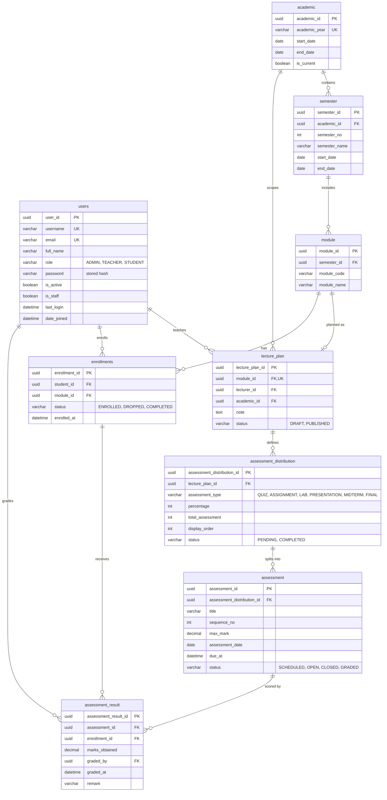

## Backend APIs for Assessment Based Student Performance Analysis System

### Current setup 
- Django REST Framework 
- Authentication Bearer Token ( Access + Refresh )
    - use https only cookie for web and response of JSON tokens for android 
### Required Version
- `python3.12.x or above`
- `mysql-server8.4`

### Installations and run the APIs
- Make sure environment variable are copy and set as described in [.env.examples](.env.examples)
    - `uv sync`
    - `uv run python3 manage.py migrate`
    - `uv run python3 manage.py runserver`

### Push notifications
`EXPO_ACCESS_TOKEN` is optional. With it set, `core/notifications.py` posts to Expo's push service when a mark is written or an assessment opens; without it every send is logged and skipped, so a local run never reaches the network. `manage.py test` blanks the token before the suite starts (see `core/test_runner.py`), so no test can deliver for real. See [docs/api-conventions.md](docs/api-conventions.md) for the delivery rules.

## ER Diagram

Domain model for running assessments. `users` matches the Django `users.User` model (`ADMIN`, `TEACHER`, `STUDENT`). Django `auth_group` and `auth_permission` stay outside this diagram.

A lecture plan is the assessment scheme for one module, offered to one teacher by an admin. Each distribution row is one assessment type inside that plan, and the marks are raw: the module is scored out of the sum of its assessment marks, with no percentage weighting. The model stops when that distribution is complete: every assessment in it, including the final, has a mark for each active enrollment. There is no grade scale, grade point, or GPA.

### Relationship rules

- `semester` is unique on `(academic_id, semester_no)`.
- `module` is unique on `(semester_id, module_code)`.
- One module has at most one `lecture_plan`. `lecture_plan.academic_id` must be the academic year of that module's semester.
- `lecture_plan.lecturer_id` references a user whose role is `TEACHER`.
- `enrollments.student_id` references a user whose role is `STUDENT`. A student enrolls in a module once: unique `(student_id, module_id)`.
- `assessment_distribution` is unique on `(lecture_plan_id, assessment_type)`. `percentage` values on one plan sum to 100. `total_assessment` is the number of `assessment` rows for that type, unique on `(assessment_distribution_id, sequence_no)`.
- One mark per student per assessment: unique `(assessment_id, enrollment_id)`. The enrollment's module must be the module of the assessment's lecture plan. `marks_obtained` is between 0 and `max_mark`. `graded_by` references a `TEACHER`.
- A distribution stays `PENDING` until every one of its assessments is `GRADED`. It then becomes `COMPLETED`. That is the end of the model. The module's assessment run is finished when its `FINAL` distribution is `COMPLETED`.

## Documentation

API contracts and the build plan are in [docs/](docs/README.md).

- [API conventions](docs/api-conventions.md) cover auth, cookies, errors, and roles.
- [Resource contract](docs/api-resources.md) lists each route and its checks.
- [Sequences](docs/sequences.md) show login, publish, marking, and distribution completion.
- [Development plan](docs/development-plan.md) is the app split and build order.
