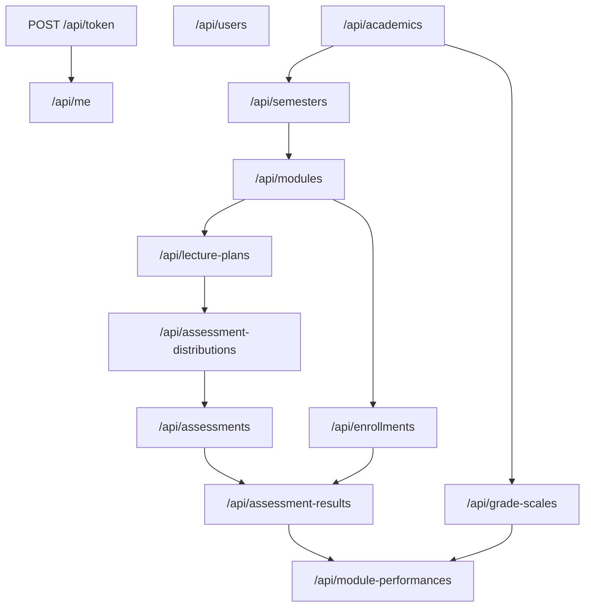
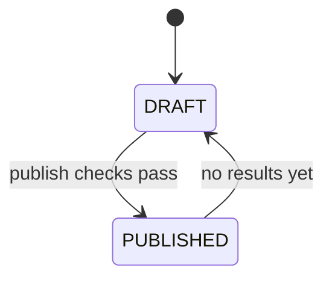
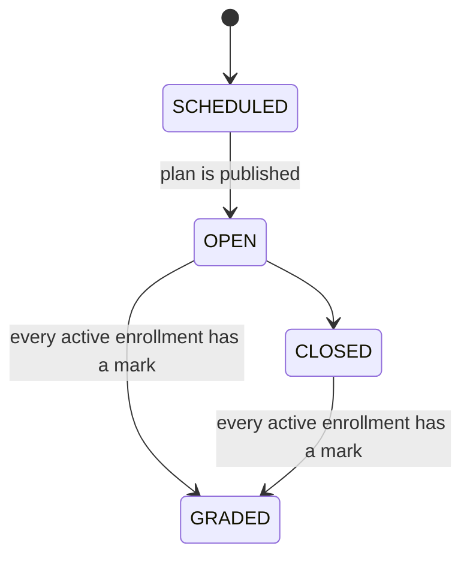

# Resource contract

Routes under `/api/`. Conventions are in [api-conventions.md](api-conventions.md). Analysis reads are in [api-analysis.md](api-analysis.md).

Grade scales and module performances are deferred. [development-plan.md](development-plan.md) ends this phase when a module's `FINAL` distribution is `COMPLETED`, so those two sections are not built yet, and the `module_performance` recompute named in the assessment result rules does not run.



Ownership in the tables means the teacher on `lecture_plan.lecturer_id` for that module. Admin includes superuser.

## Auth

### `POST /api/token/`

Implemented. Body:

```json
{
  "email": "aye@university.edu",
  "password": "secret"
}
```

| `Client-Type` | `200` body | Also |
| --- | --- | --- |
| `web` | `{"message": "Login successful (HttpOnly cookies set)"}` | Sets `access_token` and `refresh_token`. |
| `mobile` or omitted | `{"access": "<jwt>", "refresh": "<jwt>"}` | No cookies. |

`401` when the email or password is wrong, or the user is inactive. SimpleJWT's `detail` string is unchanged.

### `POST /api/token/refresh/`

| Client | Request | `200` |
| --- | --- | --- |
| Mobile, implemented | JSON `{"refresh": "<jwt>"}` | New `access` and `refresh`. The previous refresh is blacklisted once the blacklist app is installed. |
| Web, to build | `Client-Type: web` and cookie `refresh_token`. Body may be empty. | `{"message": "Token refreshed"}` plus rotated cookies. No tokens in the body. |

`401` when the refresh token is missing, expired, or blacklisted.

### `POST /api/token/logout/`

To build. Requires a valid access token or access cookie.

Blacklist the caller's refresh token and, for `Client-Type: web`, clear both cookies. Mobile may also send `{"refresh": "<jwt>"}`. Response is `204`.

## Current user

### `GET /api/me/`

Any authenticated user.

```json
{
  "id": "6d0f1a2e-7c3b-4e1a-9f0d-1a2b3c4d5e6f",
  "username": "aye.aye",
  "email": "aye@university.edu",
  "full_name": "Aye Aye",
  "role": "STUDENT",
  "is_active": true,
  "is_staff": false,
  "last_login": "2026-10-26T01:00:00Z",
  "date_joined": "2026-10-01T00:00:00Z",
  "has_push_token": true
}
```

Password is never returned.

### `POST /api/me/push-token/`

Register this device for push notifications. Body `{"push_token": "ExponentPushToken[...]"}`; anything that is not an Expo token shape returns `400`. The response is `{"has_push_token": true}`.

One token per account: a second device replaces the first, which is what a reinstall or a new phone needs. The token is a device credential, so only `has_push_token` is ever readable back.

### `DELETE /api/me/push-token/`

Forget this account's device. `204`. The mobile app calls this on sign-out.

### `PATCH /api/me/`

Fields: `full_name`, and password change via `current_password` plus `new_password`. A user cannot change `role`, `email`, `username`, or `is_active` here.

### `GET /api/me/enrollments/`

Student only. Same row shape as [enrollments](#enrollments), already limited to the caller. Teachers and admins use `/api/enrollments/`.

### `GET /api/me/lecture-plans/`

Teacher only. Same row shape as [lecture plans](#lecture-plans), limited to `lecturer_id` of the caller. Optional `status`, `academic_id` and `semester_id`.

### `GET /api/me/performance/`

Student only. Query `academic_id` optional. Same payload as the student analysis route for the caller. See [api-analysis.md](api-analysis.md).

## Dashboard

One non-paginated read that fills a whole role home, so the client does not fan out across the list endpoints to count rows.

### `GET /api/dashboard/`

Any authenticated user. The body depends on `role` of the caller; a superuser always gets the admin shape.

Three parts are shared by every role:

| Field | Shape |
| --- | --- |
| `stats[]` | `{key, label, value, tone}` tiles in render order. `value` is always a string, so a count and an academic year share one field. `tone` is `primary`, `accent`, `success`, `warning`, `danger` or `neutral`; a client falls back to `neutral` for anything else. |
| `donut` | `{title, total, slices: [{key, label, value}]}`. Every choice of the enum is present, including zero counts. |
| `bars` | `{title, series: [{key, label, tone}], groups: [{label, values}]}`. `values[key]` is a number for admin and teacher, a decimal string for the student marks chart. |

Then per role:

| Role | Extra fields |
| --- | --- |
| `ADMIN` | `recent_modules` (current academic year), `recent_enrollments` |
| `TEACHER` | `upcoming_assessments`, `recent_marks` (own grading only) |
| `STUDENT` | `upcoming_assessments` (published plans the caller is enrolled in), `recent_marks` (own results) |

```json
{
  "role": "TEACHER",
  "stats": [
    {"key": "modules", "label": "My modules", "value": "1", "tone": "primary"},
    {"key": "draft_plans", "label": "Draft plans", "value": "0", "tone": "warning"},
    {"key": "published_plans", "label": "Published plans", "value": "1", "tone": "success"},
    {"key": "open_assessments", "label": "Open assessments", "value": "1", "tone": "accent"}
  ],
  "donut": {
    "title": "Lecture plan status",
    "total": 1,
    "slices": [
      {"key": "DRAFT", "label": "Draft", "value": 0},
      {"key": "PUBLISHED", "label": "Published", "value": 1}
    ]
  },
  "bars": {
    "title": "Assessments by status",
    "series": [{"key": "count", "label": "Assessments", "tone": "primary"}],
    "groups": [{"label": "Scheduled", "values": {"count": 0}}]
  },
  "upcoming_assessments": [
    {
      "id": "3a5e...-uuid", "title": "Quiz 1", "type": "QUIZ", "type_label": "Quiz",
      "sequence_no": 1, "max_mark": "10.00", "assessment_date": "2026-10-28",
      "status": "OPEN", "status_label": "Open",
      "module_code": "CS101", "module_name": "Programming Fundamentals"
    }
  ],
  "recent_marks": [
    {
      "id": "9c2b...-uuid", "marks_obtained": "8.00", "max_mark": "10.00",
      "percentage": "80.0", "remark": "", "graded_at": "2026-10-26T01:20:00Z",
      "assessment_title": "Quiz 2", "module_code": "CS101",
      "module_name": "Programming Fundamentals", "student": "Aye Aye"
    }
  ]
}
```

Scope rules: a teacher's totals never include another lecturer's plans, and a student only sees assessments under a `PUBLISHED` plan for a module they are `ENROLLED` in. Marks come from `marking.services.percentage_of`, so a zero `max_mark` yields `null` rather than a division error.

## Users

Admin only, except `GET /api/me/`.

| Method | Path | Notes |
| --- | --- | --- |
| `GET` | `/api/users/` | Filters: `role`, `is_active`, `search`. `search` matches `full_name`, `email`, and `username`. |
| `POST` | `/api/users/` | Create. |
| `GET` | `/api/users/{id}/` |  |
| `PATCH` | `/api/users/{id}/` | Admin may change `full_name`, `role`, `is_active`, `email`, `username`. |
| `DELETE` | `/api/users/{id}/` | `409` if the user teaches a plan, is enrolled, or has graded a result. Deactivate with `is_active: false` instead. |
| `GET` | `/api/users/{id}/academic-history/` | Admin-only student result history grouped by academic year, semester, and module. |

Create body:

```json
{
  "username": "aye.aye",
  "email": "aye@university.edu",
  "full_name": "Aye Aye",
  "role": "STUDENT",
  "password": "a-long-password"
}
```

`role` is `ADMIN`, `TEACHER`, or `STUDENT`. Password rules are Django's validators. `409` on duplicate email or username.

`GET /api/me/academic-history/` exposes the same grouped result history to the signed-in student only.

## Majors and student semester placements

`/api/majors/` is an admin-managed CRUD resource (`GET` is readable by every authenticated role). A major has `code`, `name`, `duration_years` (`4` or `5`), and `is_active`; deactivate historical majors rather than deleting referenced rows.

`/api/student-placements/` is admin-only. Each row stores `student_id`, `semester_id`, `major_id`, `study_year`, `admitted_on`, and `is_current`. `study_year` must fit the major duration. Creating a current row makes the student's previous placement historical. Filters include `student_id`, `semester_id`, `academic_id`, `major_id`, `study_year`, and `is_current`.

`POST /api/student-placements/promote/` batch-promotes selected students while preserving their prior rows:

```json
{
  "student_ids": ["<uuid>", "<uuid>"],
  "target_semester_id": "<uuid>",
  "target_study_year": 2,
  "major_id": "<optional-major-override>"
}
```

Without `major_id`, each student's current major and original admission date carry forward.

## Academic setup drafts

`/api/academic-setup-drafts/` is admin-only CRUD for a resumable four-step setup. A draft stores `name`, `current_step` (1–4), and arbitrary `data` JSON without creating live academic records. Published drafts are immutable.

`POST /api/academic-setup-drafts/{id}/publish/` validates the complete draft, then creates the current academic year, exactly Semester 1 and Semester 2, the majors, and all module placements in one database transaction. Any invalid row creates nothing. The final data shape is:

```json
{
  "academic": {"academic_year": "2027-2028", "start_date": "2027-11-01", "end_date": "2028-09-30"},
  "semesters": [
    {"semester_no": 1, "semester_name": "Semester 1", "start_date": "2027-11-01", "end_date": "2028-03-31"},
    {"semester_no": 2, "semester_name": "Semester 2", "start_date": "2028-04-01", "end_date": "2028-09-30"}
  ],
  "majors": [{"code": "CS", "name": "Computer Science", "duration_years": 4}],
  "modules": [{"module_code": "CS101", "module_name": "Programming", "study_year": 1, "semester_no": 1, "major_codes": ["CS"]}]
}
```

## Academics

| Method | Path | Admin | Teacher | Student |
| --- | --- | --- | --- | --- |
| `GET` | `/api/academics/` | yes | yes | yes |
| `POST` | `/api/academics/` | yes | no | no |
| `GET` | `/api/academics/{id}/` | yes | yes | yes |
| `PATCH` | `/api/academics/{id}/` | yes | no | no |
| `DELETE` | `/api/academics/{id}/` | yes | no | no |

Filters: `is_current`.

```json
{
  "academic_year": "2026-2027",
  "start_date": "2026-12-01",
  "end_date": "2027-09-30",
  "is_current": true
}
```

Rules:

- `academic_year` is unique.
- `start_date` is before `end_date`.
- At most one row has `is_current: true`. Setting a new current year clears the previous one in the same transaction.
- Delete returns `409` when semesters or grade bands exist.

Response adds `id`.

## Semesters

| Method | Path | Admin | Teacher | Student |
| --- | --- | --- | --- | --- |
| `GET` | `/api/semesters/` | yes | yes | yes |
| `POST` | `/api/semesters/` | yes | no | no |
| `GET` | `/api/semesters/{id}/` | yes | yes | yes |
| `PATCH` | `/api/semesters/{id}/` | yes | no | no |
| `DELETE` | `/api/semesters/{id}/` | yes | no | no |

Filters: `academic_id`.

```json
{
  "academic_id": "<uuid>",
  "semester_no": 1,
  "semester_name": "First Semester",
  "start_date": "2026-12-01",
  "end_date": "2027-03-31"
}
```

Rules:

- Unique `(academic_id, semester_no)`.
- Semester dates fall inside the academic year's dates.
- Delete returns `409` when modules exist.

Response:

```json
{
  "id": "<uuid>",
  "academic_id": "<uuid>",
  "academic_year": "2026-2027",
  "semester_no": 1,
  "semester_name": "First Semester",
  "start_date": "2026-12-01",
  "end_date": "2027-03-31"
}
```

## Modules

| Method | Path | Admin | Teacher | Student |
| --- | --- | --- | --- | --- |
| `GET` | `/api/modules/` | yes | yes | enrolled modules only |
| `POST` | `/api/modules/` | yes | no | no |
| `GET` | `/api/modules/{id}/` | yes | yes | enrolled only |
| `PATCH` | `/api/modules/{id}/` | yes | no | no |
| `DELETE` | `/api/modules/{id}/` | yes | no | no |
| `POST` | `/api/modules/{id}/copy/` | yes | no | no |
| `GET` | `/api/modules/{id}/eligible-students/` | yes | no | no |

Filters: `semester_id`, `academic_id`, `lecturer_id`, `major_id`, `study_year`, `search` on `module_code` and `module_name`, `current_year` (boolean, keeps modules whose semester belongs to the current academic year), and `planned` (boolean, whether a lecture plan already exists).

```json
{
  "semester_id": "<uuid>",
  "study_year": 1,
  "module_code": "CS101",
  "module_name": "Programming Fundamentals",
  "eligible_major_ids": ["<major-uuid>"]
}
```

Rules:

- Unique `(semester_id, study_year, module_code)`.
- Delete returns `409` when a lecture plan or enrollment exists.
- Module offerings outside the current academic year are read-only and cannot be deleted.
- An empty `eligible_major_ids` list means the offering is available to every major in that semester.
- Copy accepts `target_semester_id`, requires the target academic year to be current, and copies only module details and eligible majors. It never copies the teacher, assessment plan, enrollments, or marks.
- `eligible-students` returns current students whose placement matches the module semester, study year, and eligible majors, excluding students already enrolled.

Response includes `id`, `semester_id`, `academic_id`, and `academic_year`, plus `lecture_plan`, which names the teacher the module was offered to:

```json
{
  "id": "<uuid>",
  "semester_id": "<uuid>",
  "academic_id": "<uuid>",
  "academic_year": "2026-2027",
  "study_year": 1,
  "module_code": "CS101",
  "module_name": "Programming Fundamentals",
  "lecture_plan": {
    "id": "<uuid>",
    "status": "DRAFT",
    "lecturer": { "id": "<uuid>", "full_name": "U Hla", "email": "hla@university.edu" }
  }
}
```

`lecture_plan` is `null` until an admin offers the module. It is read-only: the plan itself is written through [lecture plans](#lecture-plans).

## Grade scales

Bands used when a module snapshot is computed.

| Method | Path | Admin | Teacher | Student |
| --- | --- | --- | --- | --- |
| `GET` | `/api/grade-scales/` | yes | yes | yes |
| `POST` | `/api/grade-scales/` | yes | no | no |
| `GET` | `/api/grade-scales/{id}/` | yes | yes | yes |
| `PATCH` | `/api/grade-scales/{id}/` | yes | no | no |
| `DELETE` | `/api/grade-scales/{id}/` | yes | no | no |

Filter: `academic_id`.

```json
{
  "academic_id": "<uuid>",
  "letter": "A",
  "min_percentage": "80.00",
  "max_percentage": "100.00",
  "grade_point": "4.00"
}
```

Rules:

- Unique `(academic_id, letter)`.
- `0 <= min_percentage <= max_percentage <= 100`.
- A percentage matches the band where `min_percentage <= value <= max_percentage`, after the snapshot is rounded to two decimal places. Bands in one academic year must not overlap. Adjacent bands are valid when the next `min_percentage` is `0.01` above the previous `max_percentage`, for example `49.99` then `50.00`. The set should cover `0.00` through `100.00`.
- `grade_point` is from `0.00` to `4.00`.
- Delete returns `409` when a snapshot still points at the band.

## Lecture plans

One plan per module, and one teacher per plan. The admin **offers** a module — that creates the plan with its lecturer and the module's academic year — and the teacher then fills in the assessments. `academic_id` is stored and returned, and the server sets it from the module's semester. Clients do not send it.

| Method | Path | Admin | Teacher | Student |
| --- | --- | --- | --- | --- |
| `GET` | `/api/lecture-plans/` | all | own | enrolled modules, `PUBLISHED` only |
| `POST` | `/api/lecture-plans/` | yes | no | no |
| `GET` | `/api/lecture-plans/{id}/` | yes | own | published and enrolled |
| `PATCH` | `/api/lecture-plans/{id}/` | yes | own, `note` and `status` only through the actions below | no |
| `DELETE` | `/api/lecture-plans/{id}/` | `DRAFT` only | own `DRAFT` only | no |

Filters: `module_id`, `lecturer_id`, `academic_id`, `semester_id`, `status`.

Create:

```json
{
  "module_id": "<uuid>",
  "lecturer_id": "<uuid>",
  "note": "Weekly quiz, one midterm, one final."
}
```

Only an admin may create a plan; a teacher or student `POST` returns `403`. `lecturer_id` is required and must name a `TEACHER`. The module must belong to the current academic year (`Academic.is_current`), otherwise `400` on `module_id`. A second plan for the same module returns `409`.

Response:

```json
{
  "id": "<uuid>",
  "module": {
    "id": "<uuid>",
    "module_code": "CS101",
    "module_name": "Programming Fundamentals"
  },
  "semester": { "id": "<uuid>", "semester_no": 1, "semester_name": "First Semester" },
  "lecturer": {
    "id": "<uuid>",
    "full_name": "U Hla",
    "email": "hla@university.edu"
  },
  "academic_id": "<uuid>",
  "academic_year": "2026-2027",
  "note": "Weekly quiz, one midterm, one final.",
  "status": "DRAFT",
  "assessment_total": 0,
  "total_marks": "0.00"
}
```

`semester` is read from the module, and `status` is the planning state: `DRAFT` means the teacher is still writing the scheme, `PUBLISHED` means the module's assessment run is fixed. `assessment_total` and `total_marks` are read-only roll-ups of the child assessments — `total_marks` is the raw marks the module is scored out of, a two-decimal string.

`PATCH` on a `DRAFT` plan may change `note` and, for an admin, `lecturer_id`. `note` remains editable after publish. `module_id` never changes.

### `POST /api/lecture-plans/{id}/publish/`

Admin or the owning teacher. Empty body.

The plan moves to `PUBLISHED` only when all of these hold:

- At least one distribution exists.
- `(lecture_plan_id, assessment_type)` is unique. This is also enforced on write.
- Each distribution's `total_assessment` equals the number of child assessments.
- Each distribution's `sequence_no` values are unique and run from 1 through `total_assessment`.
- Every assessment has `max_mark` greater than 0 and a title.

Marks are raw, so any `total_marks` publishes — a module of three 10-mark quizzes is simply scored out of 30. `409` returns `fields` for each failed check. The plan stays `DRAFT`.

### `POST /api/lecture-plans/{id}/revert-to-draft/`

Allowed only when no `assessment_result` exists for the plan's assessments. Otherwise `409`.



## Assessment distributions

A row is one assessment type inside a plan: `QUIZ`, `ASSIGNMENT`, `LAB`, `PRESENTATION`, `MIDTERM`, or `FINAL`. It groups the assessments the teacher writes; it carries no weight.

| Method | Path | Who can write |
| --- | --- | --- |
| `GET` | `/api/assessment-distributions/?lecture_plan_id=` | Same visibility as the parent plan. |
| `POST` | `/api/assessment-distributions/` | Admin or owner, plan is `DRAFT`. |
| `GET` | `/api/assessment-distributions/{id}/` | Same as the plan. |
| `PATCH` | `/api/assessment-distributions/{id}/` | Admin or owner, plan is `DRAFT`. |
| `DELETE` | `/api/assessment-distributions/{id}/` | Admin or owner, plan is `DRAFT`, and no child assessment has a result. |

```json
{
  "lecture_plan_id": "<uuid>",
  "assessment_type": "QUIZ",
  "total_assessment": 4,
  "display_order": 1
}
```

`total_assessment` is the number of assessment rows the teacher will create, `display_order` is unique inside the plan. The response adds `assessment_count` and `total_marks` (a two-decimal string: the raw marks of the child assessments so far).

There is no percentage field. A payload that sends one is ignored, and the response never returns one.

After publish, type, `total_assessment`, and `display_order` are frozen. `409` on a write that would change them.

## Assessments

One scored item under a distribution.

| Method | Path | Who can write |
| --- | --- | --- |
| `GET` | `/api/assessments/` | Same visibility as the plan. |
| `POST` | `/api/assessments/` | Admin or owner, plan is `DRAFT`. |
| `GET` | `/api/assessments/{id}/` | Same as the plan. |
| `PATCH` | `/api/assessments/{id}/` | See status rules. |
| `DELETE` | `/api/assessments/{id}/` | `DRAFT` plan only, and the item has no results. |

Filters: `assessment_distribution_id`, `lecture_plan_id`, `module_id`, `status`.

```json
{
  "assessment_distribution_id": "<uuid>",
  "title": "Quiz 1",
  "sequence_no": 1,
  "max_mark": "20.00",
  "assessment_date": "2027-01-12",
  "due_at": "2027-01-12T10:30:00Z"
}
```

Server sets `status` to `SCHEDULED` on create. `sequence_no` is unique inside the distribution.

While the plan is `DRAFT`, the owner may change every field except `status` and the parent distribution.

While the plan is `PUBLISHED`:

- `title`, `assessment_date`, and `due_at` stay editable until the first result is saved.
- `max_mark`, `sequence_no`, and the parent distribution are frozen.
- Status moves only through the actions below.

### `POST /api/assessments/{id}/open/`

`SCHEDULED` to `OPEN`. The parent plan must be `PUBLISHED`. Marks are accepted from this state onward.

Every `ENROLLED` or `COMPLETED` student of the module who registered a push token gets one notification.

### `POST /api/assessments/{id}/close/`

`OPEN` to `CLOSED`. Marks remain editable.

### `POST /api/assessments/{id}/mark-graded/`

`CLOSED` or `OPEN` to `GRADED`. Every enrollment in the module with status `ENROLLED` or `COMPLETED` must already have a result. Dropped students are excluded. Otherwise `409`.

Opening a `GRADED` item is not allowed. To correct a mark, `PATCH` the result. The snapshot for that enrollment is recomputed. Status stays `GRADED`.



## Enrollments

| Method | Path | Admin | Teacher | Student |
| --- | --- | --- | --- | --- |
| `GET` | `/api/enrollments/` | all | own modules | own rows |
| `POST` | `/api/enrollments/` | yes | no | no |
| `GET` | `/api/enrollments/{id}/` | yes | own module | own row |
| `PATCH` | `/api/enrollments/{id}/` | `status` only | no | no |
| `DELETE` | `/api/enrollments/{id}/` | only when no results | no | no |

Filters: `module_id`, `student_id`, `academic_id`, `status`.

```json
{
  "student_id": "<uuid>",
  "module_id": "<uuid>"
}
```

Rules:

- `student_id` is a user with role `STUDENT`.
- The student must have a current placement in the module's semester and, when configured, an eligible major.
- Unique `(student_id, module_id)`. A repeat create returns `409`.
- Server sets `status` to `ENROLLED` and `enrolled_at` to the current time.
- `PATCH` status may be `ENROLLED`, `DROPPED`, or `COMPLETED`.
- A `DROPPED` enrollment is left out of grading completion checks and cohort rankings. Existing results are kept.
- Delete returns `409` when any result exists. Drop the enrollment instead.

Response includes `id`, `student` (`id`, `full_name`, `email`), `module` (`id`, `module_code`, `module_name`), `status`, and `enrolled_at`.

### `POST /api/enrollments/bulk/`

Admin. Atomic per request, with a skip list for students already enrolled. Other failures roll the request back.

```json
{
  "module_id": "<uuid>",
  "student_ids": ["<uuid>", "<uuid>"]
}
```

`200`:

```json
{
  "created": ["<enrollment-uuid>"],
  "skipped": [
    {"student_id": "<uuid>", "reason": "already_enrolled"}
  ]
}
```

`400` when a student id is missing or is not a `STUDENT`. Nothing is created in that case.

## Assessment results

One mark per enrollment per assessment.

| Method | Path | Admin | Teacher | Student |
| --- | --- | --- | --- | --- |
| `GET` | `/api/assessment-results/` | all | own modules | own rows |
| `POST` | `/api/assessment-results/` | yes | own module | no |
| `GET` | `/api/assessment-results/{id}/` | yes | own module | own row |
| `PATCH` | `/api/assessment-results/{id}/` | yes | own module | no |
| `DELETE` | `/api/assessment-results/{id}/` | yes, then recompute | own module, then recompute | no |

Filters: `assessment_id`, `enrollment_id`, `module_id`, `student_id`.

```json
{
  "assessment_id": "<uuid>",
  "enrollment_id": "<uuid>",
  "marks_obtained": "16.50",
  "remark": "Late by one day"
}
```

Rules:

- The plan is `PUBLISHED`.
- The assessment status is `OPEN`, `CLOSED`, or `GRADED`.
- The enrollment's module is the assessment's module.
- Enrollment status is `ENROLLED` or `COMPLETED`. `DROPPED` returns `409`.
- `0 <= marks_obtained <= max_mark`.
- Unique `(assessment_id, enrollment_id)`. A second `POST` returns `409`. Use `PATCH`.
- Server sets `graded_by` to the caller and `graded_at` to the current time. The caller must be a `TEACHER` or an admin. Admin graders are stored, and the role check allows admin.
- After a successful write or delete, recompute `module_performance` for that enrollment.
- A `POST`, `PATCH`, or `bulk` write notifies the marked students who registered a push token.

Response adds `id`, `graded_by` (`id`, `full_name`), `graded_at`, `max_mark`, and `percentage` for this item only (`marks_obtained / max_mark * 100`, one decimal string). That item percentage is not the module's overall mark.

### `POST /api/assessment-results/bulk/`

Admin or the owning teacher. One assessment, many enrollments. Atomic.

```json
{
  "assessment_id": "<uuid>",
  "results": [
    {"enrollment_id": "<uuid>", "marks_obtained": "16.50", "remark": ""},
    {"enrollment_id": "<uuid>", "marks_obtained": "12.00", "remark": ""}
  ]
}
```

Rows that already exist are updated. New rows are created. `200` returns the saved representations. Any invalid row returns `400` and saves nothing.

## Module performances

Read model. Clients do not `POST` a snapshot directly except to ask for a recompute.

| Method | Path | Admin | Teacher | Student |
| --- | --- | --- | --- | --- |
| `GET` | `/api/module-performances/` | all | own modules | own rows |
| `GET` | `/api/module-performances/{id}/` | yes | own module | own row |

Filters: `module_id`, `student_id`, `academic_id`, `enrollment_id`.

There is no `PATCH` and no `DELETE`. The next result write replaces the snapshot.

### `POST /api/module-performances/recompute/`

Admin, or a teacher limited to their own module. Body is one of:

```json
{"enrollment_id": "<uuid>"}
```

```json
{"module_id": "<uuid>"}
```

`module_id` recomputes every `ENROLLED` and `COMPLETED` enrollment in that module. `200` returns the snapshots. The formula is in [api-analysis.md](api-analysis.md).
