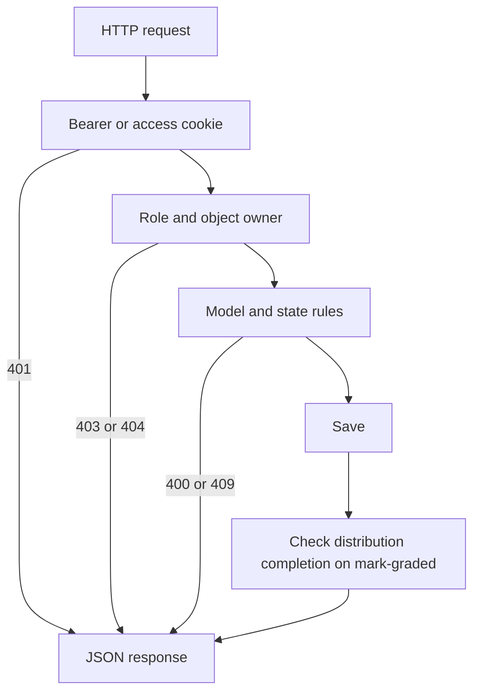

# Development plan

Build against the contracts. Do not add routes that those docs do not list. The entity rules in the [root README](../README.md) are the source for model constraints.

Scope ends when a module's `FINAL` distribution is `COMPLETED`. There is no grading scale, snapshot table, ranking, or analysis route in this phase.

## Apps

| App | Owns |
| --- | --- |
| `users` | Already present. User model, token views, cookie authentication, `/api/me/`, user admin. |
| `catalog` | `academic`, `semester`, `module`, `enrollments`. |
| `teaching` | `lecture_plan`, `assessment_distribution`, `assessment`, publish and status actions. |
| `marking` | `assessment_result` and the distribution completion check. |

`core/urls.py` includes each app under `/api/`. Token routes stay at `/api/token/` and `/api/token/refresh/` so current clients do not move.

Model field names match the ER diagram. API JSON uses `id` for the primary key and the nested shapes in [api-resources.md](api-resources.md).

## Cross-cutting work first

1. Add `rest_framework_simplejwt.token_blacklist` and migrate. Rotation already expects it.
2. Authenticate with Bearer, then with the `access_token` cookie.
3. Teach `POST /api/token/refresh/` to rotate cookies when `Client-Type` is `web`.
4. Add `POST /api/token/logout/`.
5. Install page-number pagination (`page_size` default 20, max 100) and the shared error body for new views.
6. Keep SimpleJWT's own login error body.

Until step 2 ships, document testers as mobile clients: JSON tokens and `Authorization: Bearer`.

## Build order

### 1. Users

- `GET` and `PATCH /api/me/`.
- Admin CRUD `/api/users/` with password validators and duplicate `409`.
- Tests: inactive user cannot log in. A student cannot list users.

### 2. Catalog

- Academic, semester, module.
- One current academic year.
- Semester dates inside the year.
- Enrollment create and bulk, student role check, unique `(student_id, module_id)`.
- Tests for each `409` in the resource contract.

### 3. Teaching

- Lecture plan create sets `academic_id` from the module, requires a `TEACHER` lecturer, and rejects a second plan for the module.
- Distributions and assessments only while the plan is `DRAFT`.
- Publish checks: percentage sum 100, child count equals `total_assessment`, sequences `1..n`, `max_mark > 0`.
- Status actions `open`, `close`, `mark-graded`.
- Student list hides `DRAFT` plans and modules they are not enrolled in.

### 4. Marks and distribution completion

- Single and bulk results, atomic per request.
- Range check `0..max_mark`, same-module check, `DROPPED` enrollment rejected, `graded_by` must be a `TEACHER`.
- `mark-graded` refuses when any `ENROLLED` student has no mark.
- In the same transaction as `mark-graded`: if every assessment in the distribution is `GRADED`, set the distribution to `COMPLETED`.
- When the `FINAL` distribution becomes `COMPLETED`, the module's run is finished. This is derived from the distribution status and needs no extra table.
- Tests: partial grading keeps the distribution `PENDING`. Grading the last assessment completes it. Completing `FINAL` finishes the run.

## Request path

Reads skip the completion check.

## Done check

A milestone is done when its tests cover the happy path and the `409` rules for those routes, and when a mobile client can run the matching sequence in [sequences.md](sequences.md) with Bearer tokens.

Web is done when cookie login, cookie-authenticated `GET /api/me/`, cookie refresh, and logout pass against `DEBUG=False` cookie flags in a test client.

## Deferred

Grading scale, grade points, GPA, rank, cohort statistics, and cross-semester views are out of scope until the assessment run is stable. `api-analysis.md` is removed from this phase.
