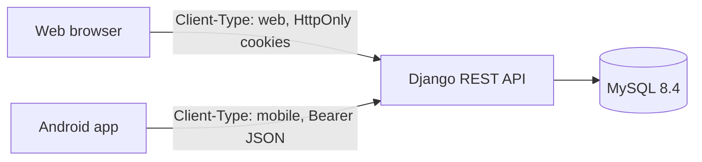
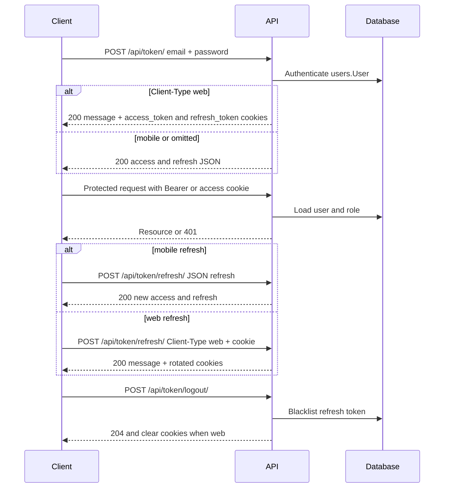
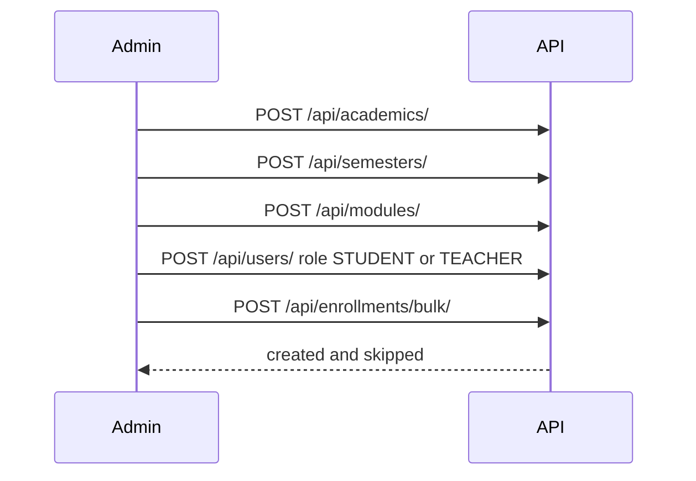
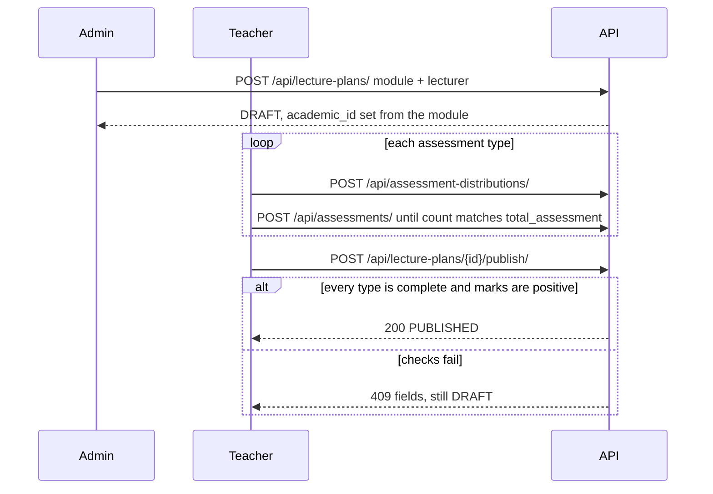
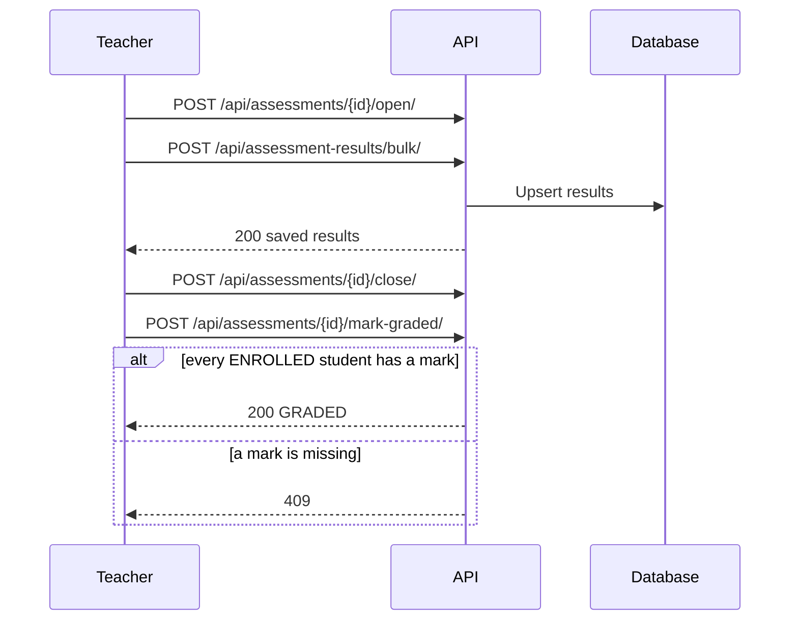
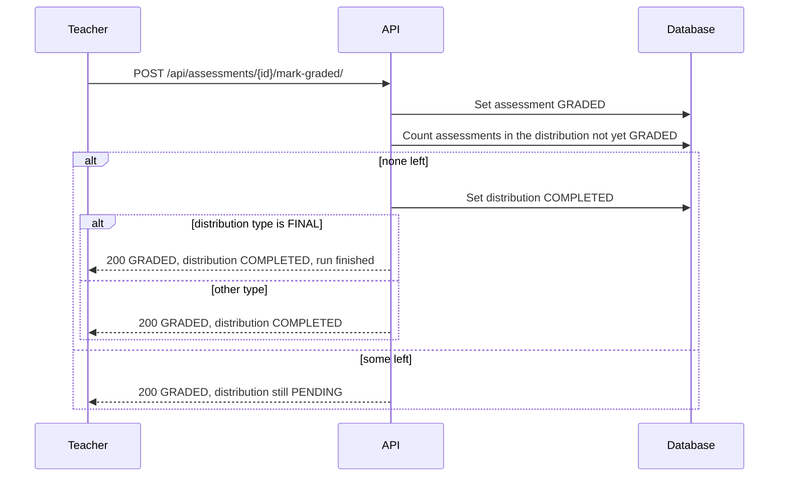
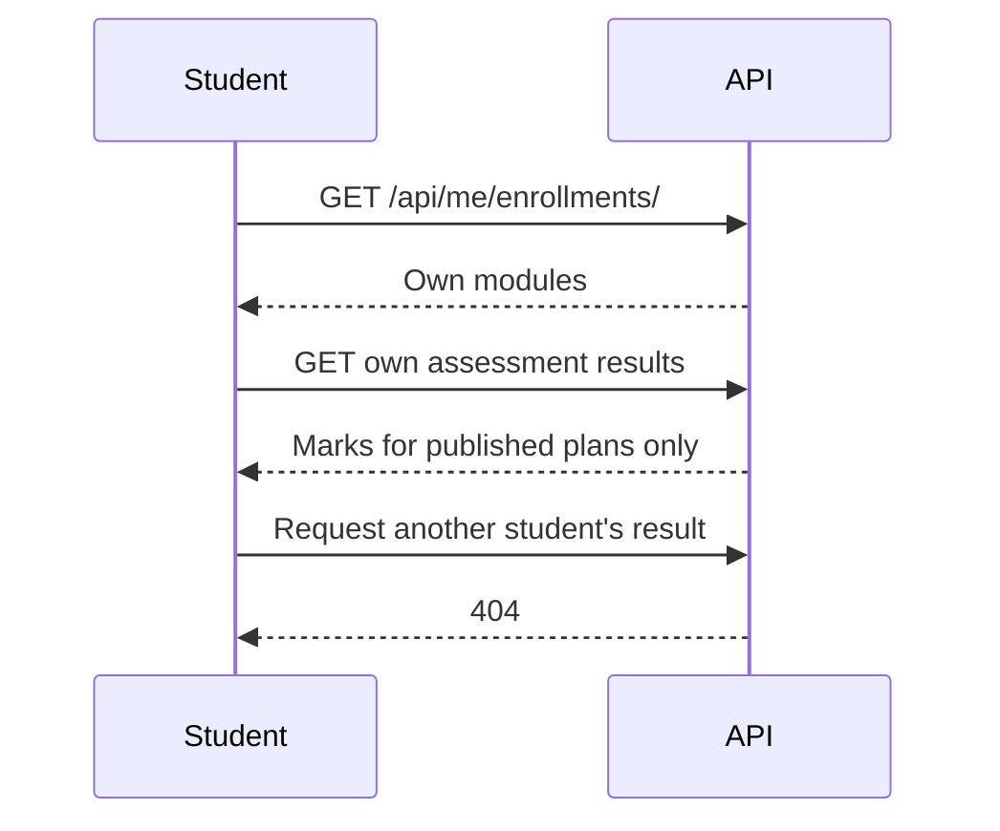

# Sequences

These match the contracts in [api-conventions.md](api-conventions.md) and [api-resources.md](api-resources.md).

## Clients

## Login and refresh

Web refresh, cookie authentication, and logout are still to build. Mobile login and JSON refresh exist.

## Academic setup

Only one academic year is current. Semester dates sit inside that year.

## Assign a module and publish the plan

A student does not see the plan until it is `PUBLISHED` and they are enrolled. Only an admin creates a plan — offering a module assigns its teacher — and the teacher then fills in the assessments.

## Record marks

`DROPPED` enrollments are not required for `GRADED`.

## Distribution completion

The check runs in the same transaction as `mark-graded`. The model stops when the `FINAL` distribution is `COMPLETED`. Nothing is computed or stored after that.

## Student reads own marks

The results route and its filters are defined in api-resources.md.
